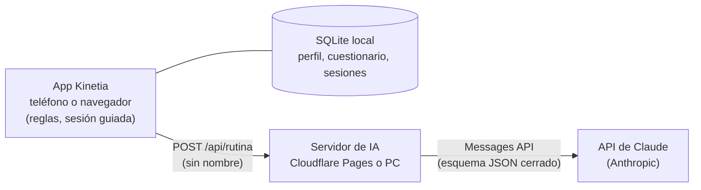

# Kinetia

Rutinas de fuerza y control corporal para quienes practican baile urbano, generadas con inteligencia artificial y
siempre dentro de límites seguros.

**Capstone (PTY4614)** · Sección 006D · Equipo 09 (trabajo individual) · Duoc UC, sede Maipú  
**Autora:** Karla Acuña Bravo · **Docente:** Aldo Alberto Martínez Órdenes

**Pruébala en la web:** https://kinetia.pages.dev (no necesita instalación ni cuenta).

## Qué es Kinetia

Kinetia complementa el entrenamiento de baile con rutinas de fuerza y control corporal para piernas, cadera, tobillos y
core, adaptadas a cada persona:

1. **Lo que la persona cuenta:** un cuestionario breve sobre su nivel, sus estilos de baile, su experiencia y lo que
   prefiere evitar, además de su edad, peso y estatura.
2. **Lo que las reglas permiten:** un motor de reglas deja solo los ejercicios compatibles y fija límites de carga según
   la edad y el IMC.
3. **Lo que decide la IA:** Claude (Anthropic) elige un ejercicio por bloque entre esas opciones, ajusta la dosis (nunca
   la sube) y explica por qué.
4. **Lo que comprueba la app:** valida cada elección antes de mostrarla. Si la IA no responde o se equivoca, usa la
   rutina por reglas y avisa el motivo.

Después, una sesión guiada acompaña cada ejercicio con animaciones propias. La respuesta a «¿Cómo te fue?» ajusta la
rutina siguiente; con dos sesiones seguidas fáciles, completas y sin molestias, se avanza a una variante más exigente.

Kinetia no enseña pasos de baile, no evalúa la técnica y no ofrece diagnóstico ni rehabilitación.

## Arquitectura

| Parte | Tecnología |
|---|---|
| Aplicación | React Native 0.86, Expo SDK 57, Expo Router y TypeScript |
| Datos | SQLite (`expo-sqlite`), solo en el dispositivo |
| Inteligencia artificial | Claude (`claude-haiku-5-5`) con salida estructurada (esquema JSON con opciones cerradas) |
| Servidor de IA | JavaScript estándar, sin dependencias: Node.js 18+ o Cloudflare Pages |
| Publicación web | Cloudflare Pages, con Wrangler |

La clave de la API vive solo en el servidor; la app nunca la conoce. El nombre de la persona nunca se envía a la IA.

## Resultados principales (06-11-2026)

- **Pruebas automáticas:** 71 de 71 correctas (unitarias, de integración y de seguridad), más una prueba de rendimiento.
- **Evaluación de la IA con un preparador físico:**
  - en 31 historias reales, su elección coincidió con la del preparador en 30 de 30 (antes de ajustar el prompt, en 18
    de 30);
  - los árboles de decisión de la Fase 2 coincidían en 23 de 30;
  - el resultado tiene límites que se explican en el documento técnico.
- **Tiempo de respuesta de la IA:** 9,7 segundos en promedio en 20 consultas reales. Ninguna superó los 45 segundos que
  espera la app.
- **Rutina por reglas:** se genera en 0,03 milisegundos en promedio.

## Cómo está organizado este repositorio

| Carpeta | Contenido |
|---|---|
| [`Fase 1/`](Fase%201/) | Definición del proyecto, presentación, autoevaluación y diario de reflexión. |
| [`Fase 2/Evidencias Grupales/`](Fase%202/Evidencias%20Grupales/) | Guías de desarrollo e informe final de la Fase 2, y planillas de evaluación. |
| [`Fase 2/Evidencias Proyecto/Evidencias de documentación/`](Fase%202/Evidencias%20Proyecto/Evidencias%20de%20documentaci%C3%B3n/) | Catálogo de ejercicios, fichas simples, reglas de generación y revisiones. |
| [`Fase 2/Evidencias Proyecto/Evidencias de sistema/Aplicacion/`](Fase%202/Evidencias%20Proyecto/Evidencias%20de%20sistema/Aplicacion/) | **Código actual de la app y del servidor de IA** (actualizado en noviembre de 2026). Su README explica cómo abrirla. |
| [`Fase 2/Evidencias Proyecto/Evidencias de sistema/Base_de_datos/`](Fase%202/Evidencias%20Proyecto/Evidencias%20de%20sistema/Base_de_datos/) | Esquema SQLite entregado en la Fase 2 (versión 1). La versión 3 está en el código y en el documento técnico. |
| [`Fase 2/Evidencias Proyecto/Evidencias de sistema/Kinetia_arbol_k11_k12_v0_3/`](Fase%202/Evidencias%20Proyecto/Evidencias%20de%20sistema/Kinetia_arbol_k11_k12_v0_3/) | Entrenamiento del árbol de decisión K11/K12 (Fase 2). |
| [`Fase 3/`](Fase%203/) | Entrega final: documento técnico, manual de usuario y pruebas automáticas. |

## Documentación

- **Documento técnico** (Fase 3): arquitectura, modelo de datos, diagramas UML, requisitos no funcionales, despliegue,
  pruebas, innovación, y límites y trabajo futuro.
- **Manual de usuario** (Fase 3): cada pantalla explicada con capturas.
- [Evaluación de la IA con el preparador físico](Fase%202/Evidencias%20Proyecto/Evidencias%20de%20sistema/Aplicacion/evidencias/Evaluacion_IA_preparador.md)
- [Servidor de IA: cómo usarlo](Fase%202/Evidencias%20Proyecto/Evidencias%20de%20sistema/Aplicacion/servidor/LEEME.md)
- [Cómo publicar la versión web](Fase%202/Evidencias%20Proyecto/Evidencias%20de%20sistema/Aplicacion/herramientas/PUBLICAR_WEB.md)

## Cómo probarla

- **En la web:** https://kinetia.pages.dev, en un navegador actualizado (no en modo incógnito, porque puede borrar los
  datos).
- **En el PC con Android:** se necesitan dos ventanas, una para el servicio de IA (con clave o en modo de prueba, sin
  costo) y otra para Expo. El paso a paso está en el
  [README de la app](Fase%202/Evidencias%20Proyecto/Evidencias%20de%20sistema/Aplicacion/README.md).

## Estado

Kinetia es un prototipo académico. Las fichas, las dosis y los nombres de los ejercicios están en revisión con un
preparador físico; por eso la versión web funciona en modo demostración, con el aviso de prototipo. Los límites
conocidos y el trabajo futuro están en el documento técnico.
